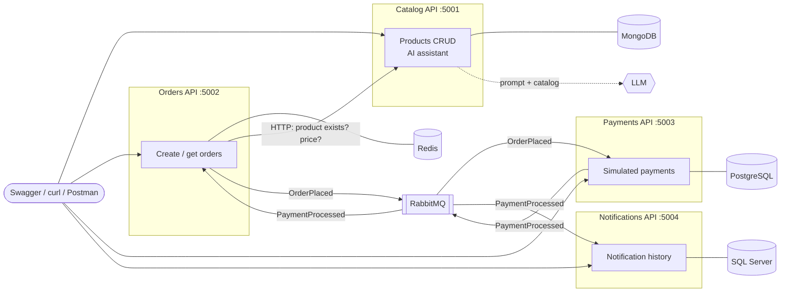

# SmartStore – .NET 8 Microservices Demo

A compact, API-only e-commerce demo: four independent .NET 8 services, each owning its own database, talking over HTTP and RabbitMQ events. Includes an AI product assistant backed by any OpenAI-compatible LLM.

> Demo MVP – payments are simulated and no real email/SMS is sent.

## Architecture



| Service | Store | Responsibility |
|---|---|---|
| **Catalog** | MongoDB | Product CRUD, seeds 8 sample products, `POST /catalog/assistant` answers product questions with an LLM |
| **Orders** | Redis (AOF persistence) | `POST /orders` checks the product with Catalog over HTTP, saves a *Pending* order, publishes `OrderPlaced`; marks it *Paid* on `PaymentProcessed` |
| **Payments** | PostgreSQL | Consumes `OrderPlaced`, simulates a successful payment, stores it, publishes `PaymentProcessed` |
| **Notifications** | SQL Server | Consumes `PaymentProcessed`, stores a notification record |

### Order workflow

1. `POST /orders { productId, quantity }` → Orders asks Catalog for the product (synchronous HTTP); unknown product → `400`, Catalog down → `503`.
2. Orders saves a **Pending** order in Redis (name and price copied from Catalog) and publishes **`OrderPlaced`**. The HTTP call returns here.
3. Payments consumes `OrderPlaced`, stores a **Succeeded** payment in PostgreSQL and publishes **`PaymentProcessed`**.
4. Orders consumes `PaymentProcessed` → order becomes **Paid**. Notifications consumes the same event (its own queue) → stores a notification in SQL Server.

All consumers are **idempotent**: RabbitMQ delivers "at least once", so a duplicate `OrderPlaced` never charges twice and a duplicate `PaymentProcessed` never creates a second notification or changes `paidAt`.

## Project layout

Every service follows the same four-project structure (inspired by [AirlineBookingSystem](https://github.com/innovativeinstitution/AirlineBookingSystem)):

```
src/
  BuildingBlocks/                 shared event contracts + MassTransit/RabbitMQ registration
  Services/
    Catalog/
      Catalog.Api/                controllers, Program.cs, Dockerfile, appsettings
      Catalog.Application/        CQRS commands/queries + MediatR handlers, DTOs, consumers
      Catalog.Core/               entities + repository/service interfaces (no dependencies)
      Catalog.Infrastructure/     MongoDB repository, LLM HTTP client, seeding
    Orders/  Payments/  Notifications/   (same structure)
tests/SmartStore.Tests/           xUnit + Moq unit tests for the handlers
docs/                             .http file, curl demo script, Postman collection
docker-compose.yml                4 APIs + 4 stores + RabbitMQ
```

Dependencies point inwards: `Api → Application → Core ← Infrastructure`. Handlers only see interfaces from Core, so storage and the LLM provider can change without touching business logic.

**Tech:** .NET 8 · ASP.NET Core · MediatR 12 (CQRS) · MassTransit 8 + RabbitMQ · MongoDB.Driver · StackExchange.Redis · EF Core 8 (Npgsql, SQL Server) · Swagger · xUnit + Moq · Docker Compose

## Getting started

### Prerequisites

- [Docker Desktop](https://www.docker.com/products/docker-desktop/) (running)
- [.NET 8 SDK](https://dotnet.microsoft.com/download) or newer – only needed to run from Visual Studio or run the tests

### Option A – everything in Docker

```bash
cp .env.example .env              # then edit .env (at least LLM_API_KEY for the AI assistant)
docker compose up -d --build
```

The first build downloads the .NET and database images (a few minutes). When it's up:

| | URL |
|---|---|
| Catalog Swagger | http://localhost:5001/swagger |
| Orders Swagger | http://localhost:5002/swagger |
| Payments Swagger | http://localhost:5003/swagger |
| Notifications Swagger | http://localhost:5004/swagger |
| RabbitMQ management | http://localhost:15672 (guest / guest) |

Stop with `docker compose down` (data is kept in volumes) or `docker compose down -v` (wipe all data).

### Option B – APIs from Visual Studio, infrastructure in Docker

```bash
docker compose up -d mongo redis postgres sqlserver rabbitmq
```

Open `SmartStore.sln`, set **multiple startup projects** (`Catalog.Api`, `Orders.Api`, `Payments.Api`, `Notifications.Api`, profile `http`) and press F5. They use the same ports (5001–5004) as the containers, so stop the API containers first if they're running:
`docker compose stop catalog-api orders-api payments-api notifications-api`.

## Configuration

Each API reads `appsettings.json`, then environment variables (`Section__Key` overrides `Section:Key`). Docker Compose passes the values from `.env` (see [`.env.example`](.env.example)): ports, database credentials, RabbitMQ login and LLM settings.

### AI assistant (LLM)

The assistant calls any **OpenAI-compatible** Chat Completions endpoint – switching provider is configuration only:

| Provider | `LLM_BASE_URL` | `LLM_API_KEY` | `LLM_MODEL` |
|---|---|---|---|
| OpenAI | `https://api.openai.com/v1` | your key | e.g. `gpt-4o-mini` |
| Ollama (local, free) | `http://host.docker.internal:11434/v1` | any text | e.g. `llama3.2` |

- **Docker:** set the values in `.env`, then `docker compose up -d catalog-api`.
- **Visual Studio:** keep the key out of source control with user-secrets:
  ```bash
  dotnet user-secrets set "Llm:ApiKey" "sk-..." --project src/Services/Catalog/Catalog.Api
  ```
  (For Ollama outside Docker use `http://localhost:11434/v1`.)

Without a valid key, `POST /catalog/assistant` returns `503 AI assistant unavailable`; everything else works normally.

## Demo walkthrough

**create product → place order → payment event → notification → ask AI**

| Tool | How |
|---|---|
| curl script | `bash docs/demo.sh` (Git Bash on Windows) – runs the whole flow and waits for the async steps |
| Visual Studio | open [`docs/smartstore.http`](docs/smartstore.http), click *Send request* top to bottom (ids are passed along automatically) |
| Postman | import [`docs/SmartStore.postman_collection.json`](docs/SmartStore.postman_collection.json), run the *Demo flow* folder with the Collection Runner (tests included) |

Or by hand:

```bash
# 1. create a product
curl -X POST http://localhost:5001/catalog/products -H "Content-Type: application/json" \
  -d '{"name":"Smart Desk Lamp","description":"LED desk lamp","category":"Home","price":49.90,"stock":25}'

# 2. order it  -> status "Pending"
curl -X POST http://localhost:5002/orders -H "Content-Type: application/json" \
  -d '{"productId":"<product id>","quantity":2}'

# 3. a moment later -> status "Paid"
curl http://localhost:5002/orders/<order id>

# 4. payment and notification
curl http://localhost:5003/payments/<order id>
curl "http://localhost:5004/notifications?orderId=<order id>"

# 5. ask the AI assistant
curl -X POST http://localhost:5001/catalog/assistant -H "Content-Type: application/json" \
  -d '{"question":"What do you have for my desk under $60?"}'
```

### API reference

| Method | Endpoint | Result |
|---|---|---|
| GET | `/catalog/products` | all products |
| GET | `/catalog/products/{id}` | 200 / 404 |
| POST | `/catalog/products` | 201 / 400 |
| PUT | `/catalog/products/{id}` | 204 / 400 / 404 |
| DELETE | `/catalog/products/{id}` | 204 / 404 |
| POST | `/catalog/assistant` | 200 answer / 400 / 503 LLM unavailable |
| POST | `/orders` | 201 Pending / 400 invalid or unknown product / 503 Catalog down |
| GET | `/orders/{id}` | 200 / 404 |
| GET | `/payments/{orderId}` | 200 / 404 |
| GET | `/notifications?orderId={id}` | list, newest first (`orderId` optional) |

## Tests

```bash
dotnet test
```

14 unit tests (xUnit + Moq) cover the handlers of all four services – including the price taken from Catalog, `OrderPlaced`/`PaymentProcessed` publishing, failed/unknown cases and duplicate-event idempotency. They use mocks only, so no Docker is needed.

## Design notes and simplifications

- **Database setup:** Payments and Notifications create their schema on startup with EF Core `EnsureCreated` (with a retry while the database is starting). Simpler than migrations; changing an entity means `docker compose down -v`.
- **No outbox:** Orders saves the order and then publishes `OrderPlaced`. If publishing failed in between, the order would stay Pending. A production system would use the Transactional Outbox pattern.
- **AI context:** the whole catalog is sent with every question – fine for a demo-sized catalog; a large one would need search/embeddings first.
- **Stock** is informational (shown to the AI assistant); orders don't decrement it.
- **Licensing:** MassTransit is pinned to v8 and MediatR to v12 – their newer major versions require a commercial license.

## License

[MIT](LICENSE)
